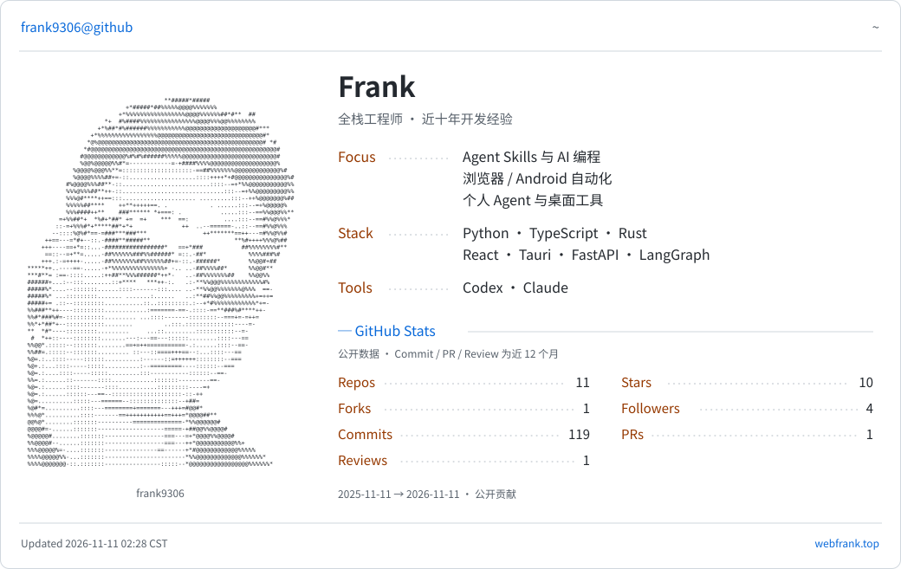

<picture>
  <source media="(max-width: 1200px) and (prefers-color-scheme: dark)" srcset="./profile/generated/mobile-dark.svg">
  <source media="(max-width: 1200px)" srcset="./profile/generated/mobile-light.svg">
  <source media="(prefers-color-scheme: dark)" srcset="./profile/generated/desktop-dark.svg">
  
</picture>

## 你好，我是 Frank

一名有近十年开发经验的全栈工程师，做过浏览器自动化引擎、RPA 平台、Linux 云桌面和虚拟化产品。现在主要做 **AI 编程工具、自动化和个人 Agent 应用**，也写一些自己日常会用到的桌面工具和浏览器扩展。

最近在做的事：

- **让 Agent 更好地参与开发**：把需求澄清、项目上下文、测试和代码审查整理成 Skills，改进多环境使用体验，探索多 Agent 协作。
- **把重复操作变成工具**：围绕浏览器、Android 和 Windows，做设备控制、脚本执行、终端和系统维护工具。
- **让个人助手用上已有资料**：探索知识检索、共享记忆和工具调用，也把这些能力用到记录、个人助手和家庭设备场景。

主要使用 **Python、TypeScript / JavaScript**，也会按项目需要使用 **Rust、C# 和 Go**。实践、排障过程和学习笔记放在[个人知识库](https://knowledge.webfrank.top/)。

### 代表项目

- [**Agent Skills**](https://github.com/frank9306/agent-skills)：把需求澄清、项目记录、测试、代码审查与 UI 操作整理成可复用的 Skills，也覆盖内容处理和服务运维。
- [**Android Use**](https://github.com/frank9306/android-use)：让 Agent 通过 MCP 或 CLI 观察、操作 Android 手机，也提供可安装的 Codex 插件。
- [**Codex Switch Helper**](https://github.com/frank9306/codex-switch-helper)：在 Windows 上管理隔离的 Codex 环境、共享 Skills 与插件，并同时运行多个实例。
- [**MindVault**](https://github.com/frank9306/MindVault)：本地优先的个人知识 Agent，围绕资料导入、混合检索和可追溯的原文引用回答问题。
- [**QuickNav**](https://github.com/frank9306/quick-nav-extension)：把浏览器新标签页变成个人导航站，管理收藏、搜索链接和记录每日备忘。
- [**aTools**](https://github.com/frank9306/aTools)：基于 Tauri、React 和 Rust 的桌面工具箱，整合进程查看、格式转换和网络查询。

### 找到我

- 个人网站：[webfrank.top](https://webfrank.top/)
- 个人知识库：[knowledge.webfrank.top](https://knowledge.webfrank.top/)
- 邮箱：[liufrank621@gmail.com](mailto:liufrank621@gmail.com)
- Telegram：[@frankl0622](https://t.me/frankl0622)
