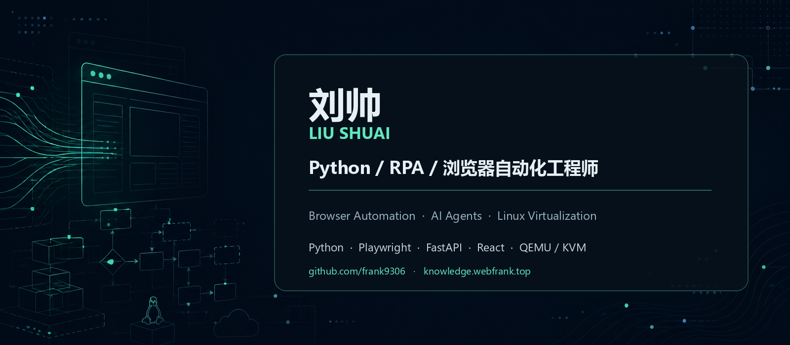

## 你好，我是刘帅

一名拥有近 10 年软件研发经验的工程师。近 3 年专注于指纹浏览器自动化引擎与 RPA 平台研发，此前长期参与 Linux 云桌面与虚拟化产品开发。

目前主要使用 Python、TypeScript 和 JavaScript，实践方向包括浏览器自动化、任务调度、Python 后端、桌面客户端与多平台交付。我也在探索如何将 Agent Skills、Codex / Claude 等 AI 工具融入 RPA 脚本生成、调试、审查与发布流程。

技术关注：`Python` · `Playwright` · `FastAPI` · `GraphQL` · `MongoDB` · `Redis` · `React` · `Linux` · `QEMU / KVM` · `AI Agent`

- 技术博客：[knowledge.webfrank.top](https://knowledge.webfrank.top/)
- GitHub：[@frank9306](https://github.com/frank9306)
